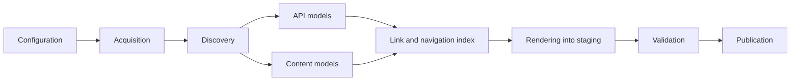

# Architecture and behavioral contracts

This document records the decisions shared by every stage of Meziantou.DocumentationGenerator. Each
decision is labeled as **Guaranteed** (tested behavior that users can rely on), **Best effort** (enrichment
that is used when metadata is available and diagnosed when it is not), **Unsupported** (rejected or
ignored with a diagnostic), or **Deferred** (out of scope for the first release).

## Pipeline



| Stage | Input | Output | Owner |
| --- | --- | --- | --- |
| Configuration | Optional `docgen.json` and command-line values | Validated, path-resolved `SiteConfiguration` | `Configuration/` |
| Acquisition | Package references | Verified `.nupkg` files in the cache | `Packages/` |
| Discovery | `.nupkg` files | Selected API assemblies, XML files, PDB candidates, metadata | `Discovery/` |
| API models | Selected assemblies | One `PublicApiAssembly` per asset, aggregated per assembly name | `Api/` (PublicApiGenerator) |
| Content models | Markdown, `_folder.yml`, XML docs | Parsed pages, navigation trees, documentation trees | `Markdown/`, `Navigation/`, `XmlDocs/` |
| Link index | All models | Routes, anchors, symbol index, cross-reference resolution | `Links/` |
| Rendering | All models + link index | Minified HTML files written into a staging directory | `Rendering/`, `Components/` |
| Validation | Staging directory | Link, anchor and collision diagnostics | `Rendering/` |
| Publication | Validated staging directory | Output directory and ownership manifest | `Rendering/OutputPublisher` |

Each stage only consumes the models produced by the previous stages. A fatal diagnostic stops the build
before publication: the output directory always contains either the previous successful site or the new
one, never a partial site.

### Ownership and lifetime of shared models

- PublicApiGenerator (`Meziantou.Framework.PublicApiGenerator`) owns metadata reading, documentation IDs,
  declaration formatting and multi-target aggregation. This repository never reads type definitions with
  its own `PEReader`/`MetadataReader` and never parses generated C#. The only direct metadata access in this
  repository is reading **portable PDBs** (sequence points and Source Link), which PublicApiGenerator does
  not cover.
- Models are immutable once a stage completes. `PublicApiAssembly` instances do not hold a reader, so the
  package archive can be closed once an assembly has been read.
- The build has no global mutable state. All state flows through a `BuildContext` created per build.
- There is no plugin framework. Extension happens by contributing to this repository.

## Package identity

**Guaranteed.**

- A *package* is a NuGet package identified by `id` + `version`. A version range is resolved to one exact version
  during acquisition; every later stage uses the resolved version.
- The API reference is organized by namespace: a namespace has a single page listing its types from every published
  package. Each published package also has a page, identified in URLs by its lowercase ID, whose lead paragraph is
  the package description.
- Pages are only the authored Markdown files. Nothing is generated from package READMEs; READMEs are never read or
  published.

### Example

```json
{ "packages": [ { "id": "Contoso.Json", "version": "2.1.0" } ] }
```

API reference at `/api/`, package page at `/api/packages/contoso.json.html`.

## Configuration

**Guaranteed.** See [configuration.md](configuration.md) for every field.

- The configuration is a JSON file (`docgen.json` by default) with comments and trailing commas allowed.
  A JSON schema is shipped in the tool package and in the repository (`schema/docgen.schema.json`).
  Every property also has a command-line argument. Command-line values replace individual properties; arrays and
  dictionaries are replaced as a whole.
- `"version": 1` is required in a file. Other values are rejected (`DG1001`). Without an explicit `--config`, a
  missing default file uses command-line values and defaults, including version `1`, without creating a file.
- Unknown properties are errors (`DG1002`), because silently ignoring a misspelled option produces a
  different site than the author expects.
- Every relative filesystem path is resolved against the directory containing the configuration file,
  except `--output`, which is resolved against the process working directory. Without a file, relative paths use
  the process working directory.
- Package versions are exact NuGet versions (`1.2.3`, `1.2.3-beta.1`), version ranges (`[1.0,2.0)`) or floating
  versions (`1.*`, `*-*`). An omitted version means `*`, the latest stable version, except automatic folder discovery
  without an ID uses `*-*` to include prereleases. A version without range syntax
  is an exact match, not a minimum version as in a `PackageReference`. Ranges resolve to the highest matching version
  (floating versions follow NuGet rules). Invalid versions are rejected (`DG1004`).
- Target framework filters use NuGet short folder names (`net8.0`, `netstandard2.0`). A filter that matches
  no asset of the package is an error (`DG2004`).
- `site.basePath` is a URL path (default `/`). It is normalized to start and end with `/`.
- `site.url` is an optional absolute `https://` or `http://` origin without path, query or fragment. The
  canonical URL of a page is `site.url` + `site.basePath` + page path. A `site.url` containing a path is
  rejected (`DG1006`) so that the path is not applied twice.

## Assembly selection: `ref/` versus `lib/`

**Guaranteed.**

- APIs are documented from **compile-time assets**: for each target framework, `ref/<tfm>/*.dll` when the
  package contains a `ref/<tfm>/` folder, otherwise `lib/<tfm>/*.dll`. This is the same choice the compiler
  makes when a project references the package.
- Runtime assets (`lib/<tfm>/` when `ref/<tfm>/` exists, and `runtimes/<rid>/lib/<tfm>/`) are **symbol
  sources only**: they are used to find PDBs and Source Link for the matching public API, never to add
  APIs. Runtime-specific (RID) assets never add or duplicate APIs (**Unsupported** for documentation).
- The folder is `lib`, not `libs`.
- `_._` placeholders mark a framework as supported without assemblies; no API is produced for it.
- Native files, resource assemblies (`*.resources.dll`) and non-managed files are ignored.
- **Source packages**: when no `ref/` or `lib/` folder contains an assembly, the `.cs` files of
  `contentFiles/{cs|any}/<tfm>/` are compiled in memory (metadata only, with XML documentation) and replace the
  compile-time assembly. It is read with PublicApiGenerator's `IncludeInternalSymbols`, so `internal` symbols are
  documented with their declared accessibility. See
  [API reference](api-reference.md#source-packages).
- The documented target frameworks are the **actual asset folders** of the package. The generator does not
  compute compatibility with consuming frameworks: a type available in `netstandard2.0` is reported as
  available in `netstandard2.0`, not in `net8.0`.

## API visibility

**Guaranteed.**

A member is documented when it is visible to a consumer of the package:

- types: `public`, or `protected`/`protected internal` nested types of an unsealed visible type;
- members: `public`, `protected`, and `protected internal` members of a visible type. `protected` members of
  a sealed type are excluded because nobody can access them;
- `private protected` and `internal` symbols are excluded, except the `internal` symbols of source packages, which
  are part of the consuming project;
- explicit interface implementations are documented when the interface is visible;
- compiler-generated members are documented only when they are part of the public contract: record
  members (`EqualityContract` is excluded, `<Clone>$` is excluded, `Deconstruct`, `Equals`, `PrintMembers`
  and `ToString` are included), property/event accessors are rendered with their property or event, never as
  separate methods;
- configured `api.include`/`api.exclude` namespace and type patterns are applied after visibility.

## Identity

**Guaranteed.**

| Entity | Identity | Example |
| --- | --- | --- |
| Input | `packageId@version` | `Contoso.Json@2.1.0` |
| Assembly scope | `packageId/assemblyName` (TFM independent) | `Contoso.Json/Contoso.Json` |
| Assembly asset | scope + TFM | `Contoso.Json/Contoso.Json` + `net8.0` |
| Symbol | assembly scope + XML documentation ID | `Contoso.Json/Contoso.Json` + `T:Contoso.Json.JsonReader` |
| Authored page | source path relative to the content root, without extension, `/` separators | `03-Guides/01-GettingStarted` |

- XML documentation IDs alone are not unique: two packages can both define `T:Utils.Guard`. Symbol lookups
  from XML or `cref:` links are resolved first in the current assembly scope, then in the current package,
  then across all configured packages; more than one match at the same level is ambiguous (`DG4002`) and no
  link is generated.
- Metadata tokens and MVIDs are provenance used for PDB lookup only; they are never part of a URL or identity.

## Routes and anchors

**Guaranteed.** API URLs never depend on display titles, discovery order, the selected TFM or unrelated symbols.
Authored page URLs are computed from folder and page titles unless a `slug` is set.

### Files and URLs

- Every page is an `.html` file. The site never requires an SPA fallback or URL rewriting.
- A page named `index.html` is linked by its directory URL (`/docs/foo/`); every other page is linked by its
  file URL (`/docs/foo/api/Foo.Bar.html`). Static hosts serve `index.html` for directory URLs.
- Shared models use site URLs with the configured base path. When writing HTML, every internal URL is made
  relative to that output file, including navigation, content, assets and search. Absolute external and metadata
  URLs are unchanged, so relocating a site does not require rebuilding unless its absolute metadata must change.
- The 404 page is file-relative too: hosts must redirect to its actual URL rather than serving it at a nested missing URL.
- Opening the site from `file://` is **Unsupported**.

The following table shows deployment URLs, not the relative attribute values emitted in HTML:

| Page | File | URL with `basePath: /` | URL with `basePath: /docs/` |
| --- | --- | --- | --- |
| Site home | `index.html` | `/` | `/docs/` |
| API reference | `api/index.html` | `/api/` | `/docs/api/` |
| Package | `api/packages/{package}.html` | `/api/packages/contoso.json.html` | `/docs/api/packages/contoso.json.html` |
| Namespace | `api/namespaces/{Namespace}.html` | `/api/namespaces/Contoso.Json.html` | `/docs/api/namespaces/Contoso.Json.html` |
| Type | `api/{TypeName}.html` | `/api/Contoso.Json.JsonReader.html` | `/docs/api/Contoso.Json.JsonReader.html` |
| Member | type page + fragment | `/api/Contoso.Json.JsonReader.html#Read(System.Int32)` | `/docs/api/Contoso.Json.JsonReader.html#Read(System.Int32)` |
| Authored page | `{folder slugs}/{page slug}.html` | `/guides/getting-started.html` | `/docs/guides/getting-started.html` |
| Root `index.md` | `index.html` (site home) | `/` | `/docs/` |
| Asset | `_assets/...`, or content-relative path | `/_assets/site.css` | `/docs/_assets/site.css` |
| Search index | `_assets/search-index.json` | `/_assets/search-index.json` | `/docs/_assets/search-index.json` |
| 404 page | `404.html` | `/404.html` | `/docs/404.html` |

### Type page names

- The type page name is the namespace-qualified name with nested types separated by `.` and generic arity
  appended with `-N` to each generic type: `Contoso.Collections.Tree-1.Node.html` for
  `Contoso.Collections.Tree<T>.Node`, `Contoso.Pair-2.html` for `Pair<TKey, TValue>`.
- Types in the global namespace use their simple name.
- Every nested type has its own page.
- Characters outside `[A-Za-z0-9._-]` are percent-encoded in URLs; file names keep the identifier characters
  (C# identifiers can contain Unicode letters).

### Collisions

- Collisions are detected **case-insensitively** because common filesystems are case-insensitive.
- Type pages do not depend on the package. When two types map to the same file, every colliding page is suffixed
  with `--{assemblyName}` (for instance two packages, or two assemblies of one package, both defining `Utils.Guard`).
  If the suffix still collides (case-only differences), a stable 8-character hash of the scoped identity is appended.
  A type of the global namespace named `index` is suffixed the same way, so that it does not replace the API
  reference page.
  Warning `DG4004` lists the involved symbols because such URLs are only stable as long as the colliding
  set is unchanged.
- Authored pages may not collide with generated pages; this is an error (`DG4005`).

### Anchors

- A member anchor is the member part of its documentation ID: the documentation ID without the kind prefix
  and declaring type. Examples:
  - `M:Contoso.Json.JsonReader.Read(System.Int32)` → `Read(System.Int32)`
  - `M:Contoso.Json.JsonReader.#ctor` → `#ctor`
  - `P:Contoso.Json.JsonReader.Item(System.String)` → `Item(System.String)`
  - `M:Contoso.Json.JsonReader.op_Implicit(System.String)~Contoso.Json.JsonReader` → `op_Implicit(System.String)~Contoso.Json.JsonReader`
  - `M:Contoso.Json.JsonReader.System#IDisposable#Dispose` → `System#IDisposable#Dispose`
- Members of C# 14 extension blocks are shown as declared in their block, not as the implementation methods the
  compiler adds to the static class. Their anchor starts with the receiver type instead of the compiler-generated
  grouping type, and the anchors of their implementation methods stay on the page, so older links keep working:
  - `P:Contoso.Json.JsonExtensions.<G>$9F2C.Depth` → `JsonReader.Depth` (also `get_Depth(Contoso.Json.JsonReader)`)
  - `M:Contoso.Json.JsonExtensions.<G>$4B1A.Create(System.Int32)` → `JsonReader.Create(System.Int32)` (also `Create(System.Int32)`)
- Overload groups get the anchor `{Name}-overloads` (`#ctor-overloads` for constructors, `{Receiver}.{Name}-overloads`
  for extension members).
- Fragments are percent-encoded in `href` attributes, the `id` attribute keeps the raw value.
- Heading anchors in authored pages follow the GitHub slug rules; duplicates get `-1`, `-2` suffixes in
  document order.

### Example: generic and nested types

```text
T:Contoso.Collections.Tree`1            -> /api/Contoso.Collections.Tree-1.html
T:Contoso.Collections.Tree`1.Node       -> /api/Contoso.Collections.Tree-1.Node.html
M:Contoso.Collections.Tree`1.Add(`0)    -> /api/Contoso.Collections.Tree-1.html#Add(`0)
M:Contoso.Collections.Tree`1.Map``1(System.Func{`0,``0})
                                        -> /api/Contoso.Collections.Tree-1.html#Map``1(System.Func{`0,``0})
```

### Example: TFM-specific members

`M:Contoso.Json.JsonReader.Read(System.ReadOnlySpan{System.Byte})` exists only for `net8.0`. It is listed on
the single `Contoso.Json.JsonReader.html` page with an availability badge `net8.0`; its anchor is the same
whether or not the `netstandard2.0` asset is documented.

### Example: identical symbol IDs in different assemblies

The packages `Contoso.A` and `Contoso.B` both define `T:Utils.Guard`:

```text
/api/Utils.Guard--Contoso.A.html   (scope Contoso.A/Contoso.A)
/api/Utils.Guard--Contoso.B.html   (scope Contoso.B/Contoso.B)
/api/namespaces/Utils.html         (lists both types)
```

A `cref:T:Utils.Guard` link in a page of package `Contoso.A` resolves to `/api/Utils.Guard--Contoso.A.html`. The same
link in an authored page is ambiguous (`DG4002`) and must be qualified with the package:
`cref:Contoso.B!T:Utils.Guard`. `cref:N:Utils` is not ambiguous: the namespace has a single page.

## Cross-references

**Guaranteed.**

- XML `cref` attributes and Markdown `cref:` links use the same resolver.
- Markdown syntax: `[text](cref:T:Contoso.Json.JsonReader)`, `[text](cref:Contoso.Json.JsonReader)` (the kind
  prefix is optional and then searched in type, method, property, field, event order), and
  `cref:{packageId}!{id}` to select a package explicitly. An empty link text uses the symbol display name.
- Symbols outside the configured packages are resolved only through `xrefs` configuration entries (by default,
  `System` and `Microsoft` to Microsoft Learn), a list of
  `{ "namespace": "System", "url": "https://learn.microsoft.com/dotnet/api/{uid}" }` where `{uid}` is the
  lowercase documentation ID without its prefix and generic arity markers replaced by `-N`. Without a matching
  mapping the reference is displayed as code without a link. Markdown `cref:` links and XML references the compiler
  could not resolve (`!:`) are reported with error `DG4001`; `diagnostics.allowInvalidCref` (or
  `--allow-invalid-cref`) makes `DG4001` and `DG4002` warnings instead. Invalid references still render their text
  without a link, explicit severity overrides take precedence, and warnings-as-errors still applies.
  Compiler-resolved XML references and signature types
  outside the configured packages are reported with info `DG4009`. The generator never guesses
  that every unresolved type is a valid Microsoft Learn URL.

## Authored content

**Guaranteed.**

- Markdown pages use YAML front matter with `title`, `description` and `slug` (optional single URL segment
  replacing the slugified title: no `/`, no `.html`; an invalid slug is error `DG5012`). Unknown
  front matter keys, including the former `uid`, are ignored.
- The page title is, in order: front matter `title`, leading level-1 heading, file name without its number prefix.
- `AGENTS.md`-style files are not skipped automatically; use `content.exclude`.
- Links to missing or excluded Markdown pages and folders without pages (`DG5001`) and to missing files (`DG5008`)
  are errors. A link to a folder targets its first page in name order; the content root targets the home page.
- **Raw HTML policy:** raw HTML in Markdown is allowed but sanitized with an allow-list: no `<script>`,
  `<style>`, `<iframe>`, `<object>`, `<embed>`, `<form>`, event handler attributes, `style` attributes, or
  URLs with schemes other than `http`, `https`, `mailto` and relative URLs. XML documentation follows the same
  URL policy and never emits raw HTML.
- Supported Markdown extensions: CommonMark, pipe tables, task lists, auto identifiers, YAML front matter,
  GitHub alerts (`> [!NOTE]`), fenced code blocks with build-time syntax highlighting, auto links,
  footnotes, and emphasis extras. DocFX-specific syntax (`[!INCLUDE]`, `:::` zones, `@uid` shorthand links,
  tabbed content) is **Unsupported** and rendered as plain Markdown.

### Navigation

**Guaranteed.** Navigation is derived from the folder structure of `content.root`; there is no table of contents file.

- Files and folders of a folder are interleaved and sorted ordinally by name, so number prefixes set the order
  (`01-Introduction.md`, `02-GettingStarted.md`, `03-Guides/`).
- Each folder may contain `_folder.yml`, a YAML mapping with `title` (display name), `description` (shown on the
  generated home page) and `slug` (URL segment). Other keys are ignored. Nesting is bounded and anchors and aliases are
  rejected. Without `_folder.yml` or `title`, the title is the folder name without its number prefix
  (`03-Guides` → `Guides`) with warning `DG5011`.
- A folder is a non-clickable group. Only folders containing at least one page appear.
- The root `index.md`, when present, is the home page and the first navigation entry. Without it, the generated home
  page lists the top-level folders (title and description, linking to their first page in name order) and the
  top-level pages.
- Routes: each folder contributes its `_folder.yml` `slug`, otherwise its slugified title; the page contributes its
  front matter `slug`, otherwise its slugified title. `01-Imaging/05-LoadingAndSaving/02-LoadingImages.md` titled
  "Imaging" / "Loading and saving" / "Loading images" → `imaging/loading-and-saving/loading-images.html`. Slugify
  removes accents, lowercases, replaces runs of characters other than ASCII letters and digits with `-`, and trims.
  The root `index.md` is always `index.html`; other `index.md` files are ordinary pages. Collisions between pages,
  between folders, and any other page mapping to `index.html` are errors (`DG4005`).
- The last section is always the generated API reference: an `API reference` node linking to `api/index.html`, then the
  namespaces of every package and their types, sorted ordinally. Packages are not part of the navigation; the API
  reference page and type pages link to them.
- Previous and next links only go through authored pages.

## Optional metadata and strictness

**Best effort**, diagnosed when unavailable:

| Missing input | Behavior | Diagnostic |
| --- | --- | --- |
| XML documentation | API pages show signatures without documentation | `DG3002` warning |
| PDB or Source Link | No source link | `DG3003` info |
| Dependency documentation for `inheritdoc` | Section omitted and marked | `DG6003` warning |

Warnings can be promoted with `diagnostics.warningsAsErrors` or `--warnaserror`, and individual codes can be
overridden with `diagnostics.severity`. Errors are never downgraded below warnings for codes that indicate
unsafe input (path traversal, collisions).

## Source links

**Best effort.** Source Link URLs are only produced when the PDB matches the assembly (PDB ID + timestamp from
the CodeView entry), the Source Link maps the document, and the host is GitHub (`raw.githubusercontent.com`
or `github.com`). Links are pinned to the commit present in the Source Link URL. Method locations come from
the first visible sequence point of the method body and are labeled *approximate*; types link to the file of
their first method. Fields and members without bodies get no line number.

## Watch mode and preview server

`build --watch` and `build --serve` are authoring conveniences; the published site is identical with or without them.

- `--watch` builds once, then rebuilds when an input changes: the configuration file, the content directory, local
  package files and the site logo, favicon and social image. Changes are grouped until the file system has been quiet
  for 300 ms. Remote packages and the cache are not watched. A failed build is reported and the previous output is kept;
  the next change triggers a new build. When the configuration cannot be loaded, the inputs of the last valid
  configuration stay watched.
- `--serve` serves the output directory on `http://localhost:<port>` under `site.basePath`, like an ordinary static
  host: directory URLs serve `index.html`, missing files redirect to `404.html` (which returns status 404), and `/`
  redirects to the base path. It uses `HttpListener`, so the tool does not require the ASP.NET Core shared framework.
- With both options, HTML responses get a `<script src="/__docgen/livereload.js">` tag inserted before `</body>` by the
  server; the generated files are not modified. The script listens to server-sent events on `/__docgen/livereload` and
  reloads the page after each successful build.

## Deferred features

Versioned sites and version selectors, API diffs, full-text and semantic search, localization, theming and
plugins, `file://` browsing, and complete DocFX compatibility are
**Deferred**.
