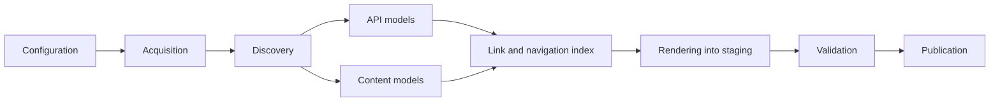

# Architecture and behavioral contracts

This document records the decisions shared by every stage of Meziantou.DocumentationGenerator. Each
decision is labeled as **Guaranteed** (tested behavior that users can rely on), **Best effort** (enrichment
that is used when metadata is available and diagnosed when it is not), **Unsupported** (rejected or
ignored with a diagnostic), or **Deferred** (out of scope for the first release).

## Pipeline



| Stage | Input | Output | Owner |
| --- | --- | --- | --- |
| Configuration | `docgen.json` | Validated, path-resolved `SiteConfiguration` | `Configuration/` |
| Acquisition | Package references | Verified `.nupkg` files in the cache | `Packages/` |
| Discovery | `.nupkg` files | Selected API assemblies, XML files, PDB candidates, README, metadata | `Discovery/` |
| API models | Selected assemblies | One `PublicApiAssembly` per asset, aggregated per assembly name | `Api/` (PublicApiGenerator) |
| Content models | Markdown, `toc.yml`, XML docs | Parsed pages, navigation trees, documentation trees | `Markdown/`, `Navigation/`, `XmlDocs/` |
| Link index | All models | Routes, anchors, symbol index, cross-reference resolution | `Links/` |
| Rendering | All models + link index | HTML files written into a staging directory | `Rendering/`, `Components/` |
| Validation | Staging directory | Link, anchor and collision diagnostics | `Rendering/` |
| Publication | Validated staging directory | Output directory and ownership manifest | `Rendering/OutputPublisher` |

Each stage only consumes the models produced by the previous stages. A fatal diagnostic stops the build
before publication: the output directory always contains either the previous successful site or the new
one, never a partial site.

### Ownership and lifetime of shared models

- PublicApiGenerator (`Meziantou.Framework.PublicApiGenerator`) owns metadata reading, documentation IDs,
  declaration formatting and multi-target aggregation. This repository never reads type definitions with
  its own `PEReader`/`MetadataReader` and never parses generated C#. The only direct metadata access in this
  repository is reading **portable PDBs** (sequence points and Source Link), which PublicApiGenerator does
  not cover.
- Models are immutable once a stage completes. `PublicApiAssembly` instances do not hold a reader, so the
  package archive can be closed once an assembly has been read.
- The build has no global mutable state. All state flows through a `BuildContext` created per build.
- There is no plugin framework. Extension happens by contributing to this repository.

## Product and package identity

**Guaranteed.**

- A *package* is a NuGet package identified by `id` + exact `version`.
- A *product* is the unit of navigation: it owns a landing page, an API reference and URLs.
- When `products` is omitted, each package becomes its own product (`id` = lowercase package ID).
- A product may group several packages. Its landing page is selected deterministically:
  1. the product `landingPage` Markdown file when configured;
  2. otherwise the README of the package named in `readmePackage`;
  3. otherwise the README of the first package listed in the product `packages` array;
  4. otherwise a generated fallback page listing packages and namespaces, with warning `DG3001`.
- A package can belong to at most one product. A package not referenced by any product while `products` is
  configured is an error (`DG1012`).

### Example: single-package product

```json
{ "packages": [ { "id": "Contoso.Json", "version": "2.1.0" } ] }
```

Product `contoso.json`, landing page from the package README.

### Example: grouped product

```json
{
  "packages": [
    { "id": "Contoso.Data", "version": "3.0.0" },
    { "id": "Contoso.Data.Sqlite", "version": "3.0.0" }
  ],
  "products": [
    { "id": "data", "name": "Contoso Data", "packages": [ "Contoso.Data", "Contoso.Data.Sqlite" ], "readmePackage": "Contoso.Data" }
  ]
}
```

## Configuration

**Guaranteed.** See [configuration.md](configuration.md) for every field.

- The configuration is a JSON file (`docgen.json` by default) with comments and trailing commas allowed.
  A JSON schema is shipped in the tool package and in the repository (`schema/docgen.schema.json`).
- `"version": 1` is required. Other values are rejected (`DG1001`).
- Unknown properties are errors (`DG1002`), because silently ignoring a misspelled option produces a
  different site than the author expects.
- Every relative filesystem path is resolved against the directory containing the configuration file,
  never the process working directory.
- Package versions must be exact NuGet versions (`1.2.3`, `1.2.3-beta.1`). Ranges are rejected (`DG1004`).
- Target framework filters use NuGet short folder names (`net8.0`, `netstandard2.0`). A filter that matches
  no asset of the package is an error (`DG2004`).
- `site.basePath` is a URL path (default `/`). It is normalized to start and end with `/`.
- `site.url` is an optional absolute `https://` or `http://` origin without path, query or fragment. The
  canonical URL of a page is `site.url` + `site.basePath` + page path. A `site.url` containing a path is
  rejected (`DG1006`) so that the path is not applied twice.
- Slugs (`products[].id`) must match `^[a-z0-9]+(?:[-.][a-z0-9]+)*$`.

## Assembly selection: `ref/` versus `lib/`

**Guaranteed.**

- APIs are documented from **compile-time assets**: for each target framework, `ref/<tfm>/*.dll` when the
  package contains a `ref/<tfm>/` folder, otherwise `lib/<tfm>/*.dll`. This is the same choice the compiler
  makes when a project references the package.
- Runtime assets (`lib/<tfm>/` when `ref/<tfm>/` exists, and `runtimes/<rid>/lib/<tfm>/`) are **symbol
  sources only**: they are used to find PDBs and Source Link for the matching public API, never to add
  APIs. Runtime-specific (RID) assets never add or duplicate APIs (**Unsupported** for documentation).
- The folder is `lib`, not `libs`.
- `_._` placeholders mark a framework as supported without assemblies; no API is produced for it.
- Native files, resource assemblies (`*.resources.dll`) and non-managed files are ignored.
- The documented target frameworks are the **actual asset folders** of the package. The generator does not
  compute compatibility with consuming frameworks: a type available in `netstandard2.0` is reported as
  available in `netstandard2.0`, not in `net8.0`.

## API visibility

**Guaranteed.**

A member is documented when it is visible to a consumer of the package:

- types: `public`, or `protected`/`protected internal` nested types of an unsealed visible type;
- members: `public`, `protected`, and `protected internal` members of a visible type. `protected` members of
  a sealed type are excluded because nobody can access them;
- `private protected` and `internal` symbols are excluded;
- explicit interface implementations are documented when the interface is visible;
- compiler-generated members are documented only when they are part of the public contract: record
  members (`EqualityContract` is excluded, `<Clone>$` is excluded, `Deconstruct`, `Equals`, `PrintMembers`
  and `ToString` are included), property/event accessors are rendered with their property or event, never as
  separate methods;
- configured `api.include`/`api.exclude` namespace and type patterns are applied after visibility.

## Identity

**Guaranteed.**

| Entity | Identity | Example |
| --- | --- | --- |
| Input | `packageId@version` | `Contoso.Json@2.1.0` |
| Assembly scope | `packageId/assemblyName` (TFM independent) | `Contoso.Json/Contoso.Json` |
| Assembly asset | scope + TFM | `Contoso.Json/Contoso.Json` + `net8.0` |
| Symbol | assembly scope + XML documentation ID | `Contoso.Json/Contoso.Json` + `T:Contoso.Json.JsonReader` |
| Authored page | path relative to the content root, without extension, `/` separators | `guides/getting-started` |

- XML documentation IDs alone are not unique: two packages can both define `T:Utils.Guard`. Symbol lookups
  from XML or `cref:` links are resolved first in the current assembly scope, then in the current product,
  then across all configured packages; more than one match at the same level is ambiguous (`DG4002`) and no
  link is generated.
- Metadata tokens and MVIDs are provenance used for PDB lookup only; they are never part of a URL or identity.

## Routes and anchors

**Guaranteed.** URLs never depend on display titles, discovery order, the selected TFM or unrelated symbols.

### Files and URLs

- Every page is an `.html` file. The site never requires an SPA fallback or URL rewriting.
- A page named `index.html` is linked by its directory URL (`/docs/foo/`); every other page is linked by its
  file URL (`/docs/foo/api/Foo.Bar.html`). Static hosts serve `index.html` for directory URLs.
- Links are root-relative and include the base path, so a page renders correctly whatever URL served it
  (including the 404 page).
- Opening the site from `file://` is **Unsupported**.

| Page | File | URL with `basePath: /` | URL with `basePath: /docs/` |
| --- | --- | --- | --- |
| Site home | `index.html` | `/` | `/docs/` |
| Product home | `{product}/index.html` | `/json/` | `/docs/json/` |
| API reference | `{product}/api/index.html` | `/json/api/` | `/docs/json/api/` |
| Namespace | `{product}/api/namespaces/{Namespace}.html` | `/json/api/namespaces/Contoso.Json.html` | `/docs/json/api/namespaces/Contoso.Json.html` |
| Type | `{product}/api/{TypeName}.html` | `/json/api/Contoso.Json.JsonReader.html` | `/docs/json/api/Contoso.Json.JsonReader.html` |
| Member | type page + fragment | `/json/api/Contoso.Json.JsonReader.html#Read(System.Int32)` | `/docs/json/api/Contoso.Json.JsonReader.html#Read(System.Int32)` |
| Authored page | `{path}.html` | `/guides/getting-started.html` | `/docs/guides/getting-started.html` |
| Authored `index.md` | `{dir}/index.html` | `/guides/` | `/docs/guides/` |
| Asset | `_assets/...`, or content-relative path | `/_assets/site.css` | `/docs/_assets/site.css` |
| Search index | `_assets/search-index.json` | `/_assets/search-index.json` | `/docs/_assets/search-index.json` |
| 404 page | `404.html` | `/404.html` | `/docs/404.html` |

### Type page names

- The type page name is the namespace-qualified name with nested types separated by `.` and generic arity
  appended with `-N` to each generic type: `Contoso.Collections.Tree-1.Node.html` for
  `Contoso.Collections.Tree<T>.Node`, `Contoso.Pair-2.html` for `Pair<TKey, TValue>`.
- Types in the global namespace use their simple name.
- Every nested type has its own page.
- Characters outside `[A-Za-z0-9._-]` are percent-encoded in URLs; file names keep the identifier characters
  (C# identifiers can contain Unicode letters).

### Collisions

- Collisions are detected **case-insensitively** because common filesystems are case-insensitive.
- When two pages of the same product map to the same file, every colliding page is suffixed with
  `--{assemblyName}` (for instance two packages of one product both defining `Utils.Guard`). If the suffix
  still collides (case-only differences), a stable 8-character hash of the scoped identity is appended.
  Warning `DG4004` lists the involved symbols because such URLs are only stable as long as the colliding
  set is unchanged.
- Authored pages may not collide with generated pages; this is an error (`DG4005`).

### Anchors

- A member anchor is the member part of its documentation ID: the documentation ID without the kind prefix
  and declaring type. Examples:
  - `M:Contoso.Json.JsonReader.Read(System.Int32)` → `Read(System.Int32)`
  - `M:Contoso.Json.JsonReader.#ctor` → `#ctor`
  - `P:Contoso.Json.JsonReader.Item(System.String)` → `Item(System.String)`
  - `M:Contoso.Json.JsonReader.op_Implicit(System.String)~Contoso.Json.JsonReader` → `op_Implicit(System.String)~Contoso.Json.JsonReader`
  - `M:Contoso.Json.JsonReader.System#IDisposable#Dispose` → `System#IDisposable#Dispose`
- Overload groups get the anchor `{Name}-overloads` (`#ctor-overloads` for constructors).
- Fragments are percent-encoded in `href` attributes, the `id` attribute keeps the raw value.
- Heading anchors in authored pages follow the GitHub slug rules; duplicates get `-1`, `-2` suffixes in
  document order.

### Example: generic and nested types

```text
T:Contoso.Collections.Tree`1            -> /json/api/Contoso.Collections.Tree-1.html
T:Contoso.Collections.Tree`1.Node       -> /json/api/Contoso.Collections.Tree-1.Node.html
M:Contoso.Collections.Tree`1.Add(`0)    -> /json/api/Contoso.Collections.Tree-1.html#Add(`0)
M:Contoso.Collections.Tree`1.Map``1(System.Func{`0,``0})
                                        -> /json/api/Contoso.Collections.Tree-1.html#Map``1(System.Func{`0,``0})
```

### Example: TFM-specific members

`M:Contoso.Json.JsonReader.Read(System.ReadOnlySpan{System.Byte})` exists only for `net8.0`. It is listed on
the single `Contoso.Json.JsonReader.html` page with an availability badge `net8.0`; its anchor is the same
whether or not the `netstandard2.0` asset is documented.

### Example: identical symbol IDs in different assemblies

`Contoso.A` and `Contoso.B`, in different products, both define `T:Utils.Guard`:

```text
/a/api/Utils.Guard.html   (scope Contoso.A/Contoso.A)
/b/api/Utils.Guard.html   (scope Contoso.B/Contoso.B)
```

A `cref:T:Utils.Guard` link in a page of product `a` resolves to `/a/api/Utils.Guard.html`. The same link in an
authored page outside any product is ambiguous (`DG4002`) and must be qualified with the package:
`cref:Contoso.B!T:Utils.Guard`.

## Cross-references

**Guaranteed.**

- XML `cref` attributes and Markdown `cref:` links use the same resolver.
- Markdown syntax: `[text](cref:T:Contoso.Json.JsonReader)`, `[text](cref:Contoso.Json.JsonReader)` (the kind
  prefix is optional and then searched in type, method, property, field, event order), and
  `cref:{packageId}!{id}` to select a package explicitly. An empty link text uses the symbol display name.
- Symbols outside the configured packages are resolved only through `xrefs` configuration entries, a list of
  `{ "namespace": "System", "url": "https://learn.microsoft.com/dotnet/api/{uid}" }` where `{uid}` is the
  lowercase documentation ID without its prefix and generic arity markers replaced by `-N`. Without a matching
  mapping the reference is displayed as code without a link and diagnosed with `DG4001` (info level for
  references discovered in signatures, warning level for explicit `cref` links). The generator never guesses
  that every unresolved type is a valid Microsoft Learn URL.

## Authored content

**Guaranteed.**

- Markdown pages use YAML front matter with `title`, `description`, `uid` (optional page identity used by
  `toc.yml` `uid` entries) and `slug` (optional route override, relative to the content root without
  extension). Unknown front matter keys are ignored.
- The page title is, in order: front matter `title`, first level-1 heading, file name.
- **Raw HTML policy:** raw HTML in Markdown is allowed but sanitized with an allow-list: no `<script>`,
  `<style>`, `<iframe>`, `<object>`, `<embed>`, `<form>`, event handler attributes, `style` attributes, or
  URLs with schemes other than `http`, `https`, `mailto` and relative URLs. XML documentation follows the same
  URL policy and never emits raw HTML.
- Supported Markdown extensions: CommonMark, pipe tables, task lists, auto identifiers, YAML front matter,
  GitHub alerts (`> [!NOTE]`), fenced code blocks with build-time syntax highlighting, auto links,
  footnotes, and emphasis extras. DocFX-specific syntax (`[!INCLUDE]`, `:::` zones, `@uid` shorthand links,
  tabbed content) is **Unsupported** and rendered as plain Markdown.

### TOC subset

**Guaranteed** subset of [DocFX table of contents](https://dotnet.github.io/docfx/docs/table-of-contents.html):

- root shapes: a top-level sequence or an object with an `items` sequence;
- node keys: `name`, `href`, `uid`, `items`, `expanded`; other keys are ignored with info `DG5007`;
- `href` to a Markdown file, an external `http(s)` URL, a nested `toc.yml` (its items are included in place)
  or a directory (`guides/`, which includes `guides/toc.yml`); a group node without `href` is not clickable;
- `uid` to an authored page `uid` or an API documentation ID (with or without prefix);
- special `href` values `api:{productId}` insert the generated API navigation of a product.
- TOC order is preserved. Generated API navigation is sorted by namespace then type name using ordinal
  comparison.
- When a page appears in several TOCs, the first occurrence in a depth-first traversal of the root TOC is its
  navigation location. A configured Markdown page that no TOC references is still generated (warning `DG5005`)
  and reachable through search.

## Optional metadata and strictness

**Best effort**, diagnosed when unavailable:

| Missing input | Behavior | Diagnostic |
| --- | --- | --- |
| README | Generated product page with package metadata and namespaces | `DG3001` warning |
| XML documentation | API pages show signatures without documentation | `DG3002` warning |
| PDB or Source Link | No source link | `DG3003` info |
| Repository metadata for README relative links | Link left unresolved and rendered as text | `DG3004` warning |
| Dependency documentation for `inheritdoc` | Section omitted and marked | `DG6003` warning |

Warnings can be promoted with `diagnostics.warningsAsErrors` or `--warnaserror`, and individual codes can be
overridden with `diagnostics.severity`. Errors are never downgraded below warnings for codes that indicate
unsafe input (path traversal, collisions).

## Source links

**Best effort.** Source Link URLs are only produced when the PDB matches the assembly (PDB ID + timestamp from
the CodeView entry), the Source Link maps the document, and the host is GitHub (`raw.githubusercontent.com`
or `github.com`). Links are pinned to the commit present in the Source Link URL. Method locations come from
the first visible sequence point of the method body and are labeled *approximate*; types link to the file of
their first method. Fields and members without bodies get no line number.

## Deferred features

Versioned sites and version selectors, API diffs, full-text and semantic search, localization, theming and
plugins, watch mode and preview server, `file://` browsing, and complete DocFX compatibility are
**Deferred**.
